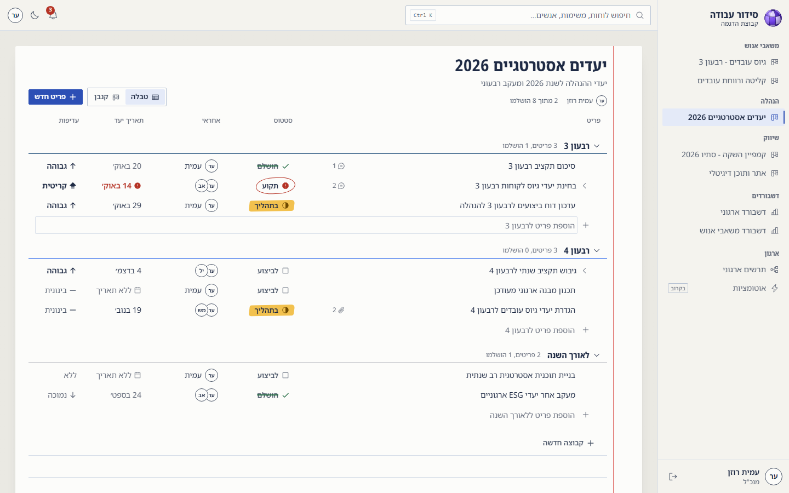
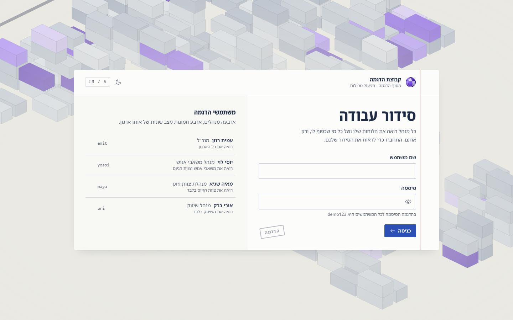
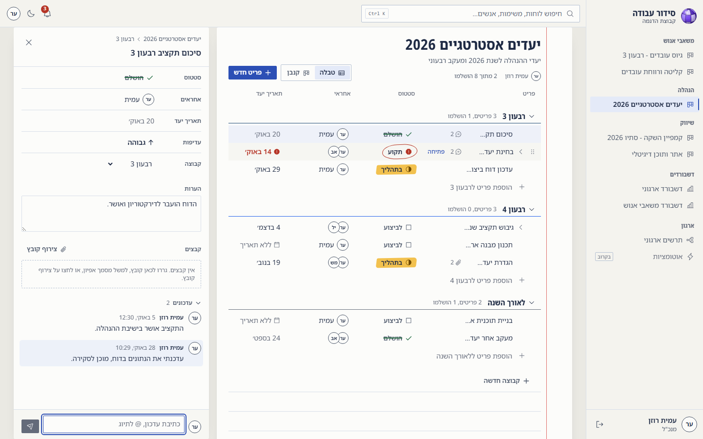
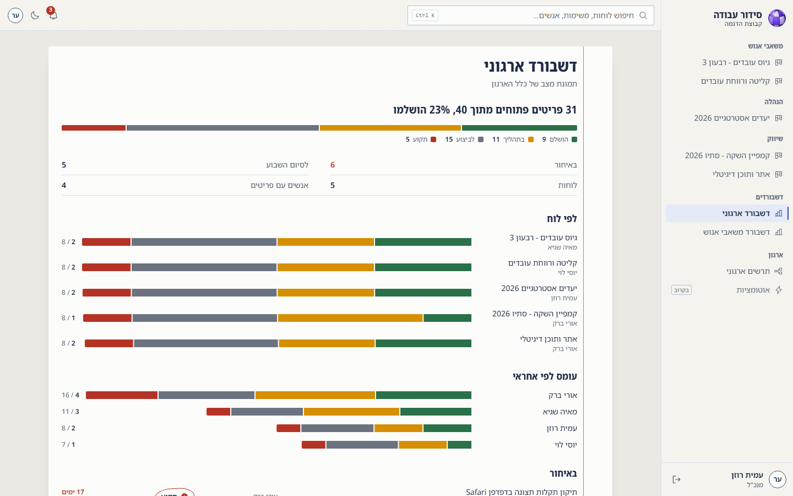
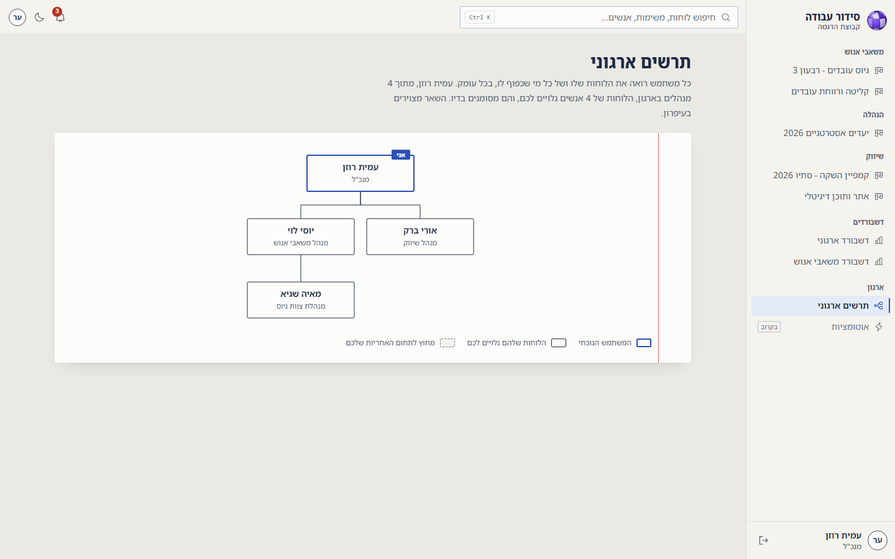
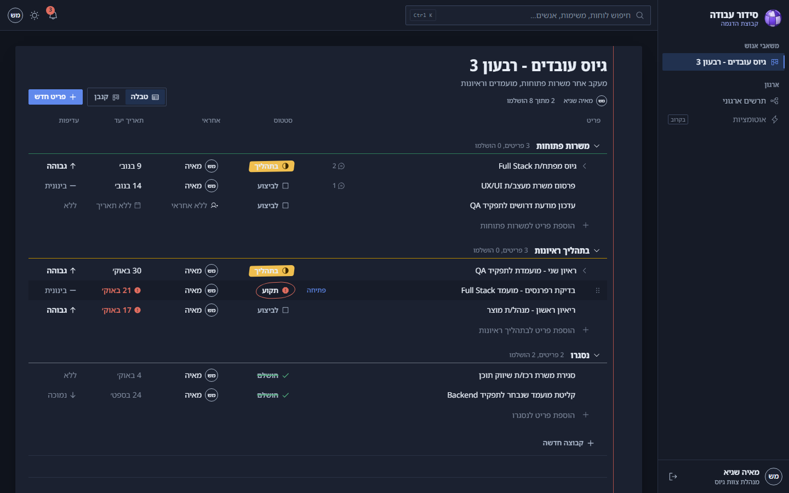
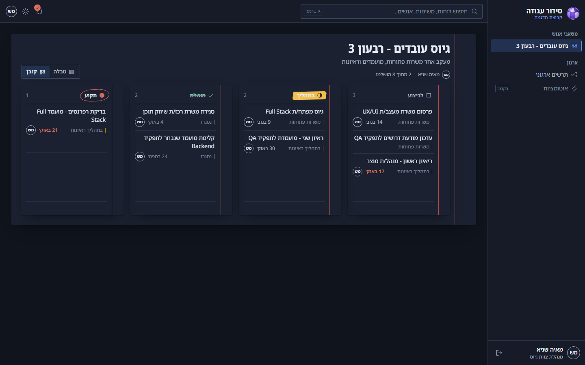

# Task Manager: boards where visibility follows the org chart

A boards-style task manager (think Monday.com) where **what you can see is derived from the org chart**.
Every manager sees their own boards and the boards of everyone below them, at any depth, and nothing
above or beside them. The UI is Hebrew and right-to-left.

**[Live demo →](https://MrCuteFace.github.io/task-manager/)**: pick any of the four demo users on the login screen.

I built this for an operations company's management team. This public version runs entirely in the browser, with
made-up people, boards and branding. The production version runs against the ASP.NET Core API in [`server/`](server).



## Try this in the demo

1. Sign in as **עמית רוזן** (CEO). Five boards across three departments, two dashboards.
2. Sign out and sign in as **מאיה שגיא** (recruiting lead). One board. The CEO's boards are not
   hidden behind a disabled button: as far as the API is concerned, they do not exist. Opening one
   by URL returns the same 404 as a board that was never created.
3. Open an item, post an update, tag someone with `@`. Change a status, drag a row to another group,
   switch to the kanban view, add your own status with a custom color.

Changes are kept for the browser tab. A new tab starts from the seed data.

## What's interesting in it

**One permission rule, enforced everywhere.** `VisibilityService` walks the org tree breadth-first
and returns the set of user ids the viewer may see. Boards, items, dashboards, search, notifications,
the org chart and the live event stream all start from that set, and every one of them has a test proving
it doesn't leak ([`server/TaskManager.Api.Tests`](server/TaskManager.Api.Tests), 118 tests).

**Custom statuses without breaking the logic that depends on them.** A board can invent any number of
statuses ("waiting for legal", "in review"…), but each one declares which of four built-in
meanings it behaves like. Overdue detection, notifications and the charts branch on the meaning,
never on the label, so none of them needed to change when custom statuses were added. Priorities work the same way.

**Live updates over server-sent events.** When someone comments, every open tab whose org tree reaches that
board refetches it. The broker filters each event through the same visibility rule before fan-out,
so a comment on one department's board never reaches a parallel manager's tab. The client reads
the stream with `fetch` rather than `EventSource` so the session token stays in a header instead of
the query string.

**Derived, not stored, notifications.** The bell (overdue, stuck, due soon, mentions) is computed from
the items you can see each time it's asked for, so it can never drift out of sync with the data.

## Screenshots

| | |
|---|---|
|  |  |
|  |  |
|  |  |

## How the static demo works

The production frontend talks to the API through three functions in `web/src/api/client.ts`. In this
build those three answer from [`web/src/api/mock`](web/src/api/mock), a TypeScript port of the C#
services that runs in the tab, seeded from the same `seed-data.json`. The hooks, caching, optimistic
updates and every component are unchanged, so the demo behaves like the real app, not like a mock-up of it.
Dates in the seed are shifted relative to today, so the board always has something due this week.

## Stack

| | |
|---|---|
| Frontend | React 19, TypeScript, Vite, Tailwind CSS 4, TanStack Query, Zustand, React Router |
| Login scene | three.js + GSAP (lazy-loaded; static under `prefers-reduced-motion`) |
| API | ASP.NET Core 8 Web API, layered (controllers → services → repositories), Swagger |
| Tests | xUnit, `WebApplicationFactory` integration tests |

## Running it

**Static demo** (no server):

```bash
cd web
npm ci
npm run dev        # http://localhost:5174
npm run build      # static site in web/dist
```

**API** (for reading the server code or running its tests):

```bash
cd server
dotnet test
dotnet run --project TaskManager.Api   # Swagger at /swagger
```

Pushing to `main` builds `web/` and publishes it to GitHub Pages ([workflow](.github/workflows/pages.yml)).
